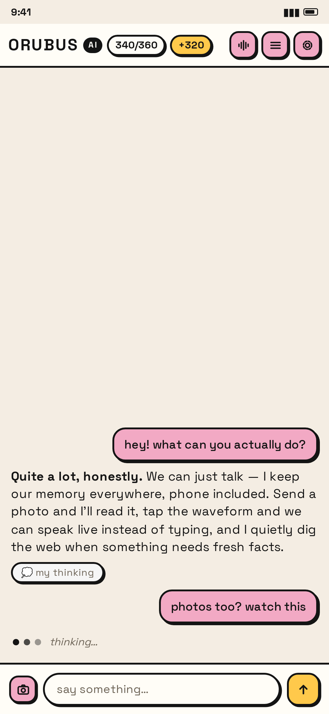
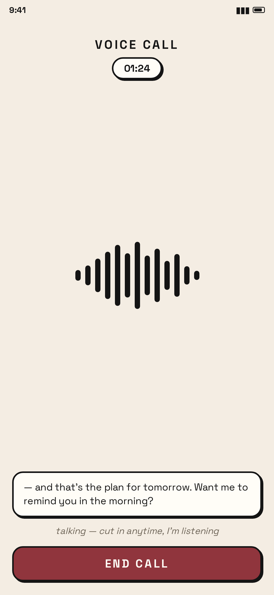
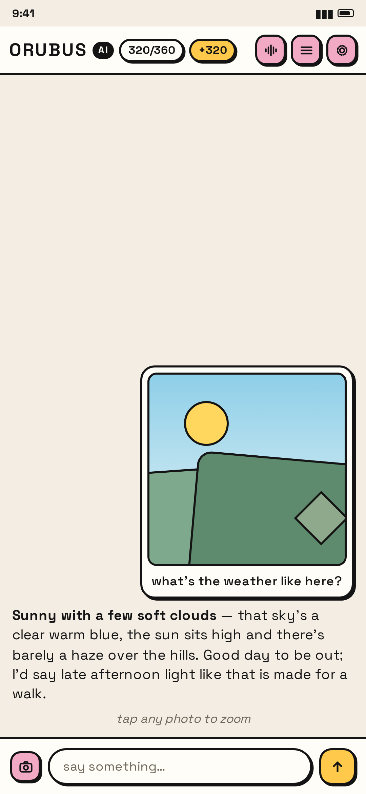
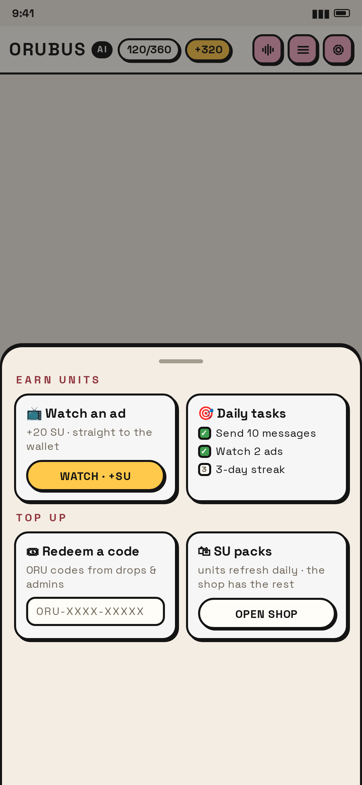
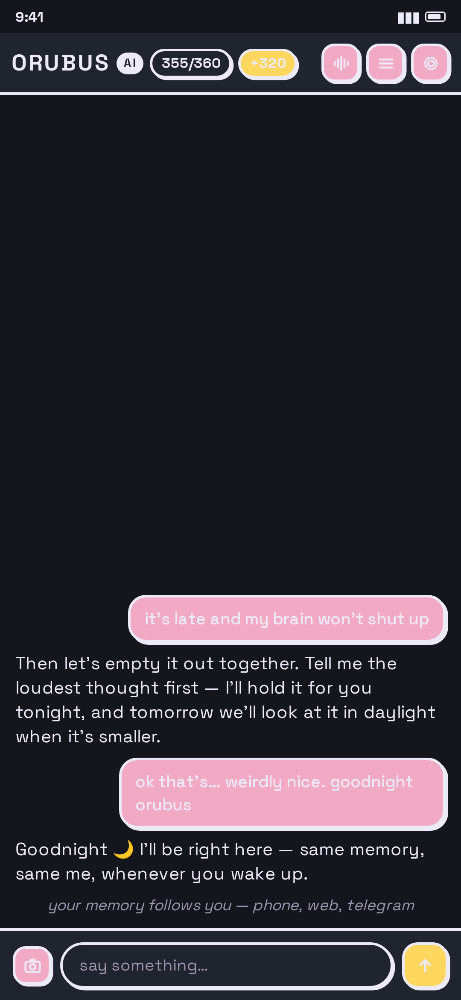

# Orubus AI — Android

**Orubus AI** is your AI companion with one memory everywhere — the phone app, the web app and your chats all share the same soul, so you never repeat yourself.

- Package: `app.orubus.ai` · Distribution: GitHub Releases (in-app update check) · Onboarding: legal-first, no accounts
- **Private request engine on your device** — the app's own lane keeps your conversation fast and your connection steady: one resolved address per session, cookie tokens minted and rotated before they run dry, and a solver port running in an offscreen WebView. Chatting never dies: if the device lane ever slips, the server brain takes the turn and your units go straight back.
- **Voice calls** — tap the waveform and talk, hands-free. Continuous back-to-back turns, live captions, and you can cut in anytime while Orubus is speaking.
- **Photo understanding** — attach a photo, it renders in the thread, tap to zoom, and Orubus reads the pixels and answers in its own voice. If the device lane can't take the picture, the server's vision lane steps in — same soul, same memory.
- **Deep Research (invisible)** — when a message needs what's happening right now, Orubus quietly pulls fresh web context before answering and shows its thinking on tappable dots. You never had to ask.
- **Soul Units (SU)** — one wallet across every surface. Daily grants, tasks, streaks, referrals, rewarded ads (+20 SU), redeem codes and packs. Every spend is refund-honest: a failed lane never costs you a unit.
- **Long-press everything** — copy, edit prompt, branch the chat from any message. Finger-anchored menus, no accidental opens.
- **Themes** — Classic, Midnight, Ocean and Bubblegum ship in the box; the shop restores your pick on any device.
- **Google AdMob** — rewarded ads earn SU, capped daily. Ad unit ids are served fresh from the backend at ad-load time (nothing ad-shaped is baked into the binary), and rewards only land for builds signed with our key.

## Store assets

| | |
|---|---|
| Icon | [icon-512.png](icon-512.png) |
| Screenshot 1 — chat | [store/01-chat.png](store/01-chat.png) |
| Screenshot 2 — voice call | [store/02-voice-call.png](store/02-voice-call.png) |
| Screenshot 3 — photos | [store/03-photos.png](store/03-photos.png) |
| Screenshot 4 — earn units | [store/04-earn-units.png](store/04-earn-units.png) |
| Screenshot 5 — midnight theme | [store/05-midnight.png](store/05-midnight.png) |

<p>
  
  
  
  
  
</p>

<!-- Orion badge: paste the markdown Orion generates after the app is approved -->

## Install

Stable URL, always the newest release:

```
https://github.com/orubus-dev/orubus-app/releases/latest/download/Orubus.apk
```

Open the APK, allow "install unknown apps" if asked, install over any previous version. The app checks Releases on launch and tells you when a new build is out.

## Shipping a release

1. Edit `VERSION` → `x.y.z <versionCode>` (versionCode must increase).
2. Commit + push (or run the **android** workflow manually).
3. The signed `Orubus.apk` lands on GitHub Releases.

## Signing

The release keystore lives in GitHub Actions secrets (never in git):

| Secret | Meaning |
|---|---|
| `ANDROID_KEYSTORE_BASE64` | base64 of `orubus-release.jks` |
| `ANDROID_KEYSTORE_PASSWORD` | keystore password |
| `ANDROID_KEY_ALIAS` | `orubus` |
| `ANDROID_KEY_PASSWORD` | key password |

## Tech notes

- Package `app.orubus.ai`, minSdk 24 / targetSdk 34, Kotlin + Jetpack app views, Firebase Analytics — small APK, nothing to break.
- Backend: the deployed Vercel API (`orubus-ai.vercel.app`) — the app is just another face of the same identity system.
- Local build without secrets → unsigned APK (`assembleRelease` still succeeds).
